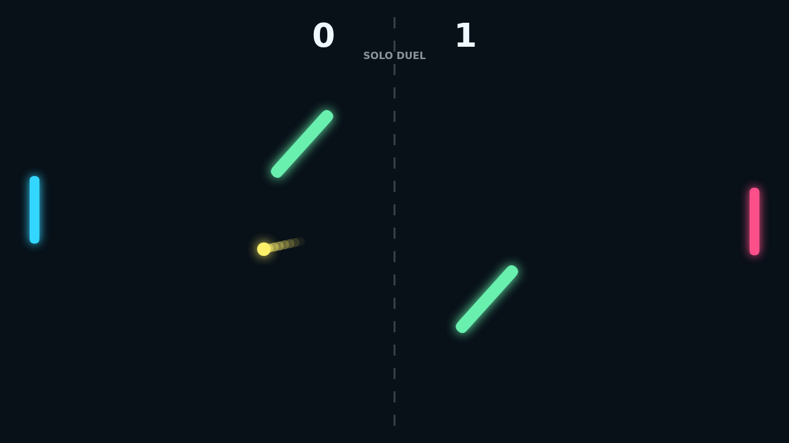
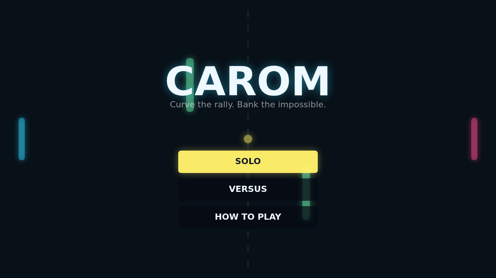

# Carom

Carom is a fast paddle duel where every rally starts clean and quickly turns
strange. The ball does not just rebound; it bends after contact, carrying the
motion of the paddle into a curving line that can pull a shot away from the
obvious return.

The two midfield bars keep the table from feeling empty. They sway, rotate, and
turn straight shots into bank-shot puzzles, so a safe return can become a sharp
angle if it catches the moving geometry at the right moment.

Solo mode puts you against a steady defender, while Versus lets two players
share the keyboard. Matches play to eleven with a two-point lead, and long
deuces become a test of spin control as much as reflexes.

